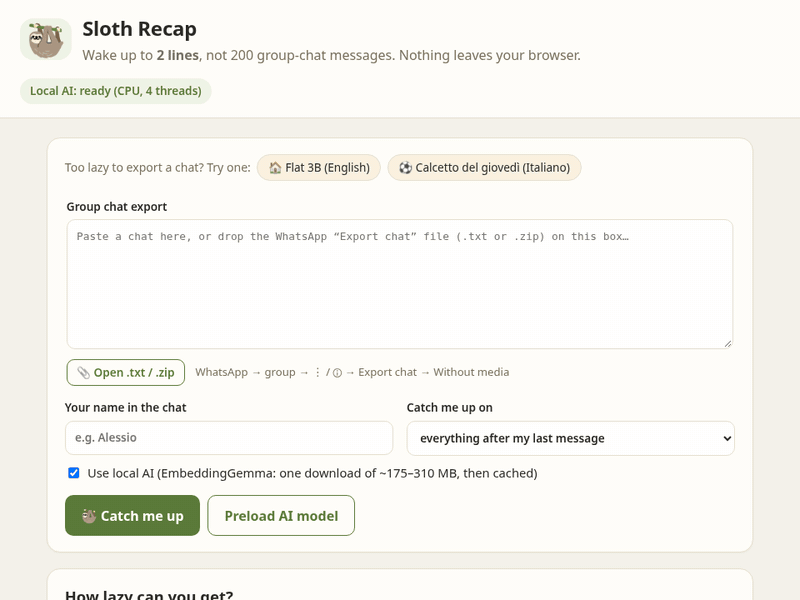
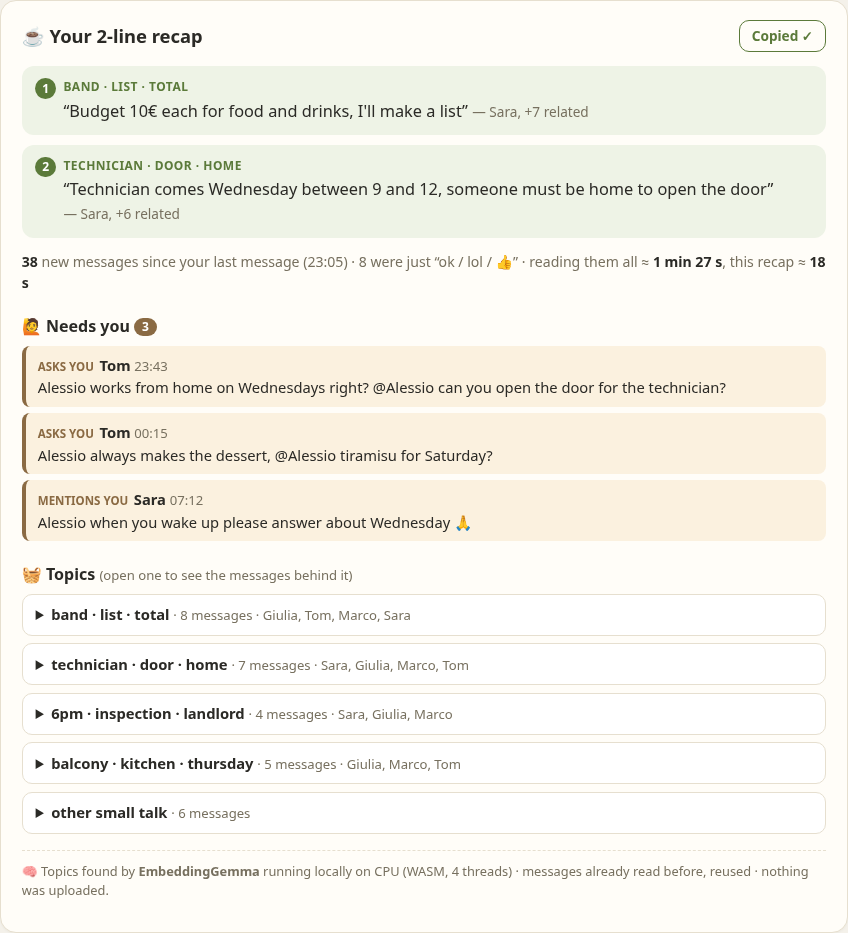

# 🦥 Sloth Recap

**Wake up to 2 lines, not 200 group-chat messages.**

Sloth Recap reads a group chat export (WhatsApp `.txt` or `.zip`, or pasted text) and gives you:

- **a 2-line recap** of what happened since your last message,
- **🙋 Needs you**: the messages that mention you or ask you something,
- **🧺 topics**: every message grouped under the line it belongs to, if you want the details.

Everything runs **in your browser**. The open-weight model [EmbeddingGemma](https://ai.google.dev/gemma/docs/embeddinggemma) runs locally with [transformers.js](https://github.com/huggingface/transformers.js). There is no server, no account and no API key, and your chat is never uploaded.

👉 **Live demo:** https://asosa933.github.io/sloth-recap/ (click a sample chat, then "Catch me up")





Built for the DEV [Hacktoberfest Open-Source AI Challenge, Week 3: "Slow and Steady"](https://dev.to/challenges/hacktoberfest-week3-2026-10-19). The project was created during the Week 3 window (October 2026).

## The lazy payoff

On the built-in "Flat 3B" sample, 38 messages arrived overnight after my last message. The app says that reading them all takes about **1 min 27 s** (word count at 200 words per minute). The recap plus the "needs you" list takes about **18 s**, and I only need to answer 3 messages. The more active the group, the bigger the saving.

Sloth Recap **only quotes real messages**. It picks them and never writes new text, so it can't invent a plan nobody made.

## How it works

```
chat export ──► parser (WhatsApp Android/iPhone, EN/IT dates, multi-line, media/system lines)
            ──► "catch-up window" = messages after your last one
            ──► drop fillers ("ok", "lol", "👍", "notte")
            ──► EmbeddingGemma vectors (in a Web Worker)  ─┐   or TF-IDF vectors if the AI is off/fails
            ──► center + mix in neighbours' context        ◄┘
            ──► pick key messages (topic size + concrete facts + recency, MMR to avoid repeats)
            ──► group every message under its closest key message
            ──► 2 lines + "needs you" (name mentions / questions, rule based) + topics
```

- `src/parse.js`: chat export parser (pure JS, tested)
- `src/digest.js`: catch-up window, fillers, "needs you", TF-IDF fallback, key-message picking and grouping (pure JS, tested)
- `src/model-worker.js`: EmbeddingGemma in a Web Worker. It uses WebGPU (4-bit, about 175 MB) when available and the CPU otherwise (8-bit, about 310 MB). The download happens once and the browser caches it.
- `src/zip.js`: reads the `.txt` out of a WhatsApp "Export chat" zip with the browser's built-in `DecompressionStream`
- `sw.js` + `src/coi.js`: a tiny service worker that turns on cross-origin isolation, so the model can use several CPU threads on GitHub Pages

More screenshots: [Italian sample](docs/recap-calcetto.png) · [no-AI fallback](docs/fallback-flat.png) · [mobile](docs/mobile.png) · [home](docs/home.png)

**Deterministic fallback:** if you untick "Use local AI", or the model can't load, the same pipeline runs on TF-IDF keyword vectors. It's a bit less accurate but instant and needs no download.

## Measurements (my own, small)

`node eval/eval-model.mjs` runs the real model in Node on 5 small chats that I wrote and labelled by hand: the 2 demo chats plus 3 held-out ones, including a mixed Italian/English chat. It's a sanity check, not a benchmark. Full output: [`eval/results.txt`](eval/results.txt).

| | EmbeddingGemma | TF-IDF fallback |
|---|---|---|
| nearest message is about the same topic | 67/88 (76%) | 64/88 (73%) |
| real topics covered by the top 3 lines | 14/15 | 14/15 |
| messages grouped under the right line | 72/81 (89%) | 64/78 (82%) |
| mixed-language chat, grouped right | 11/13 | 9/13 |

Speed, measured in headless Chrome on my CPU-only test machine (no GPU):

- 4-bit "no_gather" model, 1 thread: 38 messages in about 26 s
- 8-bit model, 1 thread: about 8 s
- 8-bit model, 4 threads (cross-origin isolated): about 3 s ← what the app uses on CPU

The first visit also downloads the model once: about 25-30 s in my tests on a fast connection.

## Run it locally

```bash
git clone https://github.com/asosa933/sloth-recap && cd sloth-recap
python3 -m http.server 8000      # or: npx serve .
# open http://localhost:8000
npm test                          # 11 unit tests (parser, digest, zip), no dependencies
npm i --no-save @huggingface/transformers && npm run eval   # optional: real-model evaluation
```

## Credits and licenses

- Code: MIT © 2026 Alessio Sosa (see [LICENSE](LICENSE)).
- Model: **EmbeddingGemma** (300M) by Google, used through the ONNX export [`onnx-community/embeddinggemma-300m-ONNX`](https://huggingface.co/onnx-community/embeddinggemma-300m-ONNX). The weights are provided under the [Gemma Terms of Use](https://ai.google.dev/gemma/terms). They are **not** included in this repo; your browser downloads them from Hugging Face.
- Runtime: [transformers.js](https://github.com/huggingface/transformers.js) (Apache-2.0) and ONNX Runtime Web.
- The demo chats are invented. All names are fictional.

**AI disclosure:** I'm a beginner and I built this with a lot of help from an AI coding assistant (code, tests, debugging, measurements). The idea, the product choices and the testing are mine.
